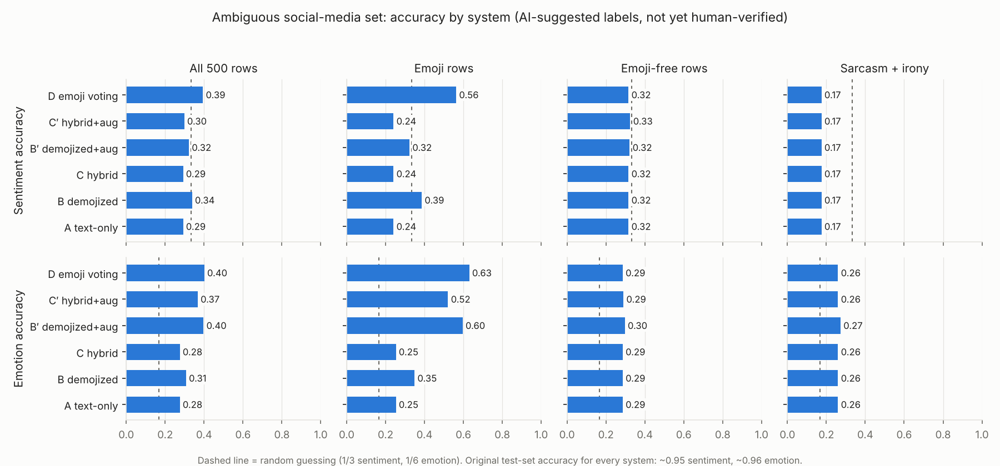
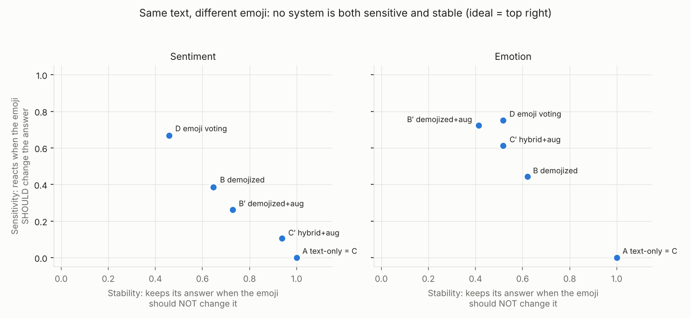

# Emoji & Ambiguity Experiments — Comparison Report

Research question: *To what extent can emoji-aware feature extraction improve sentiment and emotion classification on ambiguous social media text compared with conventional text-only machine learning and rule-based emoji integration?*

Systems: **A** existing text-only Linear SVM (primary benchmark) · **B** demojized TF-IDF SVM · **C** hybrid text + emoji-feature SVM · **B′/C′** the same trained on a synthetic emoji-augmented copy of the training split · **D** existing `predictor.py` (A + rule-based emoji voting).

> **Three different evaluations — do not compare their numbers directly.** (1) the original test split (11,796 rows, same distribution as training, no emojis); (2) the ambiguous set (500 hand-written social-media sentences, very different style) with AI-suggested labels; (3) the same set restricted to human-verified labels. A drop from (1) to (2) measures how badly the model transfers, not a single "true" accuracy.

## 1. Original test split — sentiment (existing benchmark and experimental models)

| System | Accuracy | Macro precision | Macro recall | Macro F1 | Weighted F1 |
|---|---|---|---|---|---|
| A text-only | 0.946 | 0.946 | 0.946 | 0.946 | 0.946 |
| B demojized | 0.946 | 0.946 | 0.946 | 0.946 | 0.946 |
| C hybrid | 0.946 | 0.946 | 0.946 | 0.946 | 0.946 |
| B′ demojized+aug | 0.945 | 0.945 | 0.945 | 0.945 | 0.945 |
| C′ hybrid+aug | 0.946 | 0.946 | 0.946 | 0.946 | 0.946 |
| D emoji voting | identical to A on this split (it contains no emojis) | | | | |

## 1. Original test split — emotion (existing benchmark and experimental models)

| System | Accuracy | Macro precision | Macro recall | Macro F1 | Weighted F1 |
|---|---|---|---|---|---|
| A text-only | 0.963 | 0.963 | 0.963 | 0.963 | 0.963 |
| B demojized | 0.963 | 0.963 | 0.963 | 0.963 | 0.963 |
| C hybrid | 0.963 | 0.963 | 0.963 | 0.963 | 0.963 |
| B′ demojized+aug | 0.961 | 0.961 | 0.961 | 0.961 | 0.961 |
| C′ hybrid+aug | 0.960 | 0.960 | 0.960 | 0.960 | 0.960 |
| D emoji voting | identical to A on this split (it contains no emojis) | | | | |

## 2. Ambiguous set — AI-suggested labels (NOT human-verified)

Emotion metrics exclude the 64 rows whose emotion fits none of the six classes.

### All 500 rows — sentiment

| System | Accuracy | Macro precision | Macro recall | Macro F1 | Weighted F1 |
|---|---|---|---|---|---|
| A text-only | 0.292 | 0.367 | 0.405 | 0.291 | 0.263 |
| B demojized | 0.338 | 0.406 | 0.444 | 0.339 | 0.318 |
| C hybrid | 0.292 | 0.367 | 0.405 | 0.291 | 0.263 |
| B′ demojized+aug | 0.322 | 0.383 | 0.424 | 0.323 | 0.303 |
| C′ hybrid+aug | 0.298 | 0.371 | 0.413 | 0.297 | 0.267 |
| D emoji voting | 0.394 | 0.443 | 0.481 | 0.394 | 0.382 |

### All 500 rows — emotion

| System | Accuracy | Macro precision | Macro recall | Macro F1 | Weighted F1 |
|---|---|---|---|---|---|
| A text-only | 0.275 | 0.212 | 0.201 | 0.199 | 0.262 |
| B demojized | 0.307 | 0.280 | 0.246 | 0.251 | 0.295 |
| C hybrid | 0.275 | 0.212 | 0.201 | 0.199 | 0.262 |
| B′ demojized+aug | 0.397 | 0.465 | 0.364 | 0.387 | 0.393 |
| C′ hybrid+aug | 0.367 | 0.361 | 0.303 | 0.317 | 0.358 |
| D emoji voting | 0.401 | 0.473 | 0.371 | 0.394 | 0.400 |

### Emoji-containing rows (158) — sentiment

| System | Accuracy | Macro precision | Macro recall | Macro F1 | Weighted F1 |
|---|---|---|---|---|---|
| A text-only | 0.241 | 0.361 | 0.337 | 0.238 | 0.263 |
| B demojized | 0.386 | 0.452 | 0.444 | 0.368 | 0.427 |
| C hybrid | 0.241 | 0.361 | 0.337 | 0.238 | 0.263 |
| B′ demojized+aug | 0.323 | 0.397 | 0.356 | 0.311 | 0.371 |
| C′ hybrid+aug | 0.241 | 0.375 | 0.337 | 0.239 | 0.265 |
| D emoji voting | 0.563 | 0.491 | 0.497 | 0.478 | 0.568 |

### Emoji-containing rows (158) — emotion

| System | Accuracy | Macro precision | Macro recall | Macro F1 | Weighted F1 |
|---|---|---|---|---|---|
| A text-only | 0.253 | 0.189 | 0.193 | 0.182 | 0.243 |
| B demojized | 0.349 | 0.375 | 0.315 | 0.310 | 0.337 |
| C hybrid | 0.253 | 0.189 | 0.193 | 0.182 | 0.243 |
| B′ demojized+aug | 0.596 | 0.691 | 0.595 | 0.607 | 0.593 |
| C′ hybrid+aug | 0.521 | 0.470 | 0.447 | 0.450 | 0.512 |
| D emoji voting | 0.630 | 0.718 | 0.627 | 0.651 | 0.628 |

### Emoji-free rows (342) — sentiment

| System | Accuracy | Macro precision | Macro recall | Macro F1 | Weighted F1 |
|---|---|---|---|---|---|
| A text-only | 0.316 | 0.375 | 0.423 | 0.312 | 0.273 |
| B demojized | 0.316 | 0.375 | 0.423 | 0.312 | 0.273 |
| C hybrid | 0.316 | 0.375 | 0.423 | 0.312 | 0.273 |
| B′ demojized+aug | 0.322 | 0.376 | 0.431 | 0.318 | 0.278 |
| C′ hybrid+aug | 0.325 | 0.377 | 0.435 | 0.321 | 0.279 |
| D emoji voting | 0.316 | 0.375 | 0.423 | 0.312 | 0.273 |

### Emoji-free rows (342) — emotion

| System | Accuracy | Macro precision | Macro recall | Macro F1 | Weighted F1 |
|---|---|---|---|---|---|
| A text-only | 0.286 | 0.237 | 0.202 | 0.207 | 0.277 |
| B demojized | 0.286 | 0.237 | 0.202 | 0.207 | 0.277 |
| C hybrid | 0.286 | 0.237 | 0.202 | 0.207 | 0.277 |
| B′ demojized+aug | 0.297 | 0.268 | 0.215 | 0.222 | 0.286 |
| C′ hybrid+aug | 0.290 | 0.272 | 0.211 | 0.218 | 0.279 |
| D emoji voting | 0.286 | 0.237 | 0.202 | 0.207 | 0.277 |

### Paired examples (161) — sentiment

| System | Accuracy | Macro precision | Macro recall | Macro F1 | Weighted F1 |
|---|---|---|---|---|---|
| A text-only | 0.292 | 0.458 | 0.416 | 0.290 | 0.308 |
| B demojized | 0.435 | 0.523 | 0.523 | 0.424 | 0.467 |
| C hybrid | 0.292 | 0.458 | 0.416 | 0.290 | 0.308 |
| B′ demojized+aug | 0.366 | 0.468 | 0.443 | 0.362 | 0.404 |
| C′ hybrid+aug | 0.286 | 0.458 | 0.412 | 0.280 | 0.295 |
| D emoji voting | 0.602 | 0.569 | 0.593 | 0.554 | 0.617 |

### Paired examples (161) — emotion

| System | Accuracy | Macro precision | Macro recall | Macro F1 | Weighted F1 |
|---|---|---|---|---|---|
| A text-only | 0.236 | 0.173 | 0.175 | 0.162 | 0.232 |
| B demojized | 0.319 | 0.400 | 0.294 | 0.291 | 0.317 |
| C hybrid | 0.236 | 0.173 | 0.175 | 0.162 | 0.232 |
| B′ demojized+aug | 0.569 | 0.685 | 0.573 | 0.585 | 0.574 |
| C′ hybrid+aug | 0.500 | 0.477 | 0.440 | 0.439 | 0.500 |
| D emoji voting | 0.618 | 0.697 | 0.619 | 0.638 | 0.619 |

### Sarcasm and irony (80) — sentiment

| System | Accuracy | Macro precision | Macro recall | Macro F1 | Weighted F1 |
|---|---|---|---|---|---|
| A text-only | 0.175 | 0.294 | 0.238 | 0.147 | 0.203 |
| B demojized | 0.175 | 0.294 | 0.238 | 0.147 | 0.203 |
| C hybrid | 0.175 | 0.294 | 0.238 | 0.147 | 0.203 |
| B′ demojized+aug | 0.175 | 0.295 | 0.238 | 0.149 | 0.204 |
| C′ hybrid+aug | 0.175 | 0.298 | 0.238 | 0.153 | 0.205 |
| D emoji voting | 0.175 | 0.294 | 0.238 | 0.147 | 0.203 |

### Sarcasm and irony (80) — emotion

| System | Accuracy | Macro precision | Macro recall | Macro F1 | Weighted F1 |
|---|---|---|---|---|---|
| A text-only | 0.260 | 0.306 | 0.191 | 0.183 | 0.323 |
| B demojized | 0.260 | 0.306 | 0.191 | 0.183 | 0.323 |
| C hybrid | 0.260 | 0.306 | 0.191 | 0.183 | 0.323 |
| B′ demojized+aug | 0.273 | 0.310 | 0.195 | 0.188 | 0.338 |
| C′ hybrid+aug | 0.260 | 0.304 | 0.191 | 0.182 | 0.322 |
| D emoji voting | 0.260 | 0.306 | 0.191 | 0.183 | 0.323 |

Confusion matrices for every system: `results/ambiguity/ai_suggested_all/confusion_*.png`.

### Significance vs A (exact McNemar test on the same rows)

```
(exact McNemar; 'wins' = rows only this system got right, 'losses' = only A got right)
  all rows   sentiment B_orig  wins  29 / losses   6  p = 0.0001  (significant at 0.05)
  all rows   sentiment C_orig  wins   0 / losses   0  p = 1.0000
  all rows   sentiment B_aug   wins  22 / losses   7  p = 0.0081  (significant at 0.05)
  all rows   sentiment C_aug   wins   9 / losses   6  p = 0.6072
  all rows   sentiment D       wins  58 / losses   7  p = 0.0000  (significant at 0.05)
  all rows   emotion   B_orig  wins  22 / losses   8  p = 0.0161  (significant at 0.05)
  all rows   emotion   C_orig  wins   0 / losses   0  p = 1.0000
  all rows   emotion   B_aug   wins  68 / losses  15  p = 0.0000  (significant at 0.05)
  all rows   emotion   C_aug   wins  53 / losses  13  p = 0.0000  (significant at 0.05)
  all rows   emotion   D       wins  61 / losses   6  p = 0.0000  (significant at 0.05)
  emoji rows sentiment B_orig  wins  29 / losses   6  p = 0.0001  (significant at 0.05)
  emoji rows sentiment C_orig  wins   0 / losses   0  p = 1.0000
  emoji rows sentiment B_aug   wins  20 / losses   7  p = 0.0192  (significant at 0.05)
  emoji rows sentiment C_aug   wins   6 / losses   6  p = 1.0000
  emoji rows sentiment D       wins  58 / losses   7  p = 0.0000  (significant at 0.05)
  emoji rows emotion   B_orig  wins  22 / losses   8  p = 0.0161  (significant at 0.05)
  emoji rows emotion   C_orig  wins   0 / losses   0  p = 1.0000
  emoji rows emotion   B_aug   wins  59 / losses   9  p = 0.0000  (significant at 0.05)
  emoji rows emotion   C_aug   wins  45 / losses   6  p = 0.0000  (significant at 0.05)
  emoji rows emotion   D       wins  61 / losses   6  p = 0.0000  (significant at 0.05)
```



## 3. Paired emoji robustness (same text, different emoji)

| System | Task | Variant accuracy | Sensitivity | Stability | Text overrides emoji | Harmful emoji flip | Emoji dominance |
|---|---|---|---|---|---|---|---|
| A text-only | sentiment | 0.27 | 0.00 | 1.00 | 1.00 | 0.00 | 0.00 |
| A text-only | emotion | 0.23 | 0.00 | 1.00 | 1.00 | 0.00 | 0.00 |
| B demojized | sentiment | 0.49 | 0.39 | 0.65 | 0.61 | 0.15 | 0.38 |
| B demojized | emotion | 0.40 | 0.44 | 0.62 | 0.56 | 0.30 | 0.12 |
| C hybrid | sentiment | 0.27 | 0.00 | 1.00 | 1.00 | 0.00 | 0.00 |
| C hybrid | emotion | 0.23 | 0.00 | 1.00 | 1.00 | 0.00 | 0.00 |
| B′ demojized+aug | sentiment | 0.36 | 0.26 | 0.73 | 0.74 | 0.10 | 0.12 |
| B′ demojized+aug | emotion | 0.68 | 0.72 | 0.41 | 0.28 | 0.25 | 0.38 |
| C′ hybrid+aug | sentiment | 0.25 | 0.10 | 0.94 | 0.90 | 0.10 | 0.00 |
| C′ hybrid+aug | emotion | 0.60 | 0.61 | 0.52 | 0.39 | 0.12 | 0.12 |
| D emoji voting | sentiment | 0.70 | 0.67 | 0.46 | 0.33 | 0.20 | 0.62 |
| D emoji voting | emotion | 0.74 | 0.75 | 0.52 | 0.25 | 0.10 | 0.50 |



## 4. Human-verified evaluation

Not available yet: no rows are marked `human_verified`. After review, run `python src/evaluate_ambiguity.py --build-verified` and then this script again.
